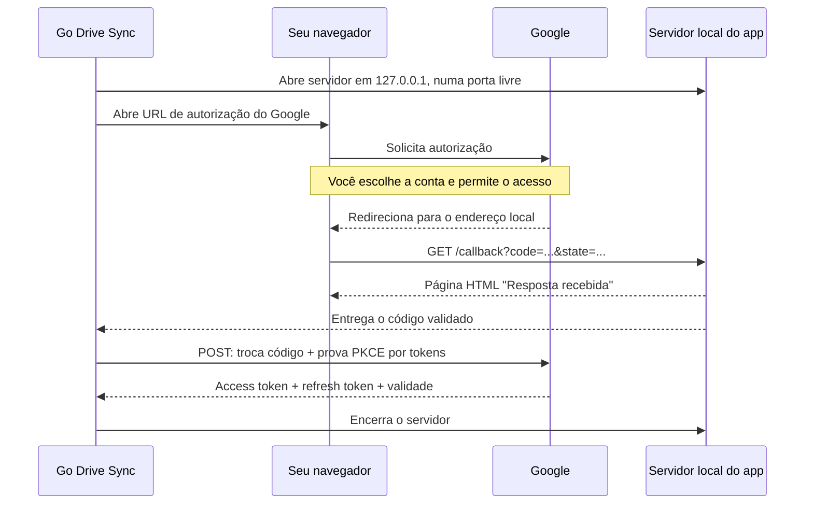

# Preparar o Google Cloud para OAuth Desktop

Este guia atende à preparação da [issue #6](https://github.com/allanJacques/go-drive-sync/issues/6).
Em 13/11/2026, o mantenedor confirmou a conclusão do roteiro no Console. Na cópia
local, foram conferidos o JSON do cliente Desktop, os campos obrigatórios, os
endpoints padrão do Google, a permissão `600` e a exclusão do arquivo do Git.
API habilitada, consentimento, usuários de teste e escopo são registrados com base
nessa confirmação; essas configurações não foram consultadas diretamente no Console.
O OAuthManager da [issue #7](https://github.com/allanJacques/go-drive-sync/issues/7)
já lê `credentials.json`. Em 13/11/2026, `./gradlew oauthLogin` concluiu o fluxo
real pelo navegador, recebendo access token e refresh token sem gravá-los nem
exibi-los. Essa validação cobre a autorização e a troca, não sincronização ou
renovação dos tokens. A issue #10 permite iniciar OAuth pelos botões Adicionar/Reconectar
na interface Compose; veja [Conexão de contas](LOGIN-E-CONTAS.md).
A issue #8 acrescenta identificação e persistência criptografada em serviço separado,
com o diagnóstico `oauthAccountLogin`; consulte [Tokens e contas](TOKENS-E-CONTAS.md).

## Configuração no Console

Mantenha o mesmo projeto selecionado durante todos os passos. Os nomes em inglês
ajudam a localizar os menus quando a tradução do Console variar.

1. Acesse o [Google Cloud Console](https://console.cloud.google.com/) com a conta
   que administrará o projeto. No seletor de projetos, escolha **Novo projeto**,
   nomeie como **Go Drive Sync**, crie e selecione-o. O ID pode manter o valor único
   sugerido pelo Google. Veja [criação de projetos](https://developers.google.com/workspace/guides/create-project).
2. Em **APIs e serviços → Biblioteca**, procure **Google Drive API** e clique em
   **Ativar**. Confira se aparece como habilitada. Essa é a API usada pelo cliente,
   conforme o [guia Java do Drive](https://developers.google.com/drive/api/quickstart/java).
3. Em **Google Auth Platform → Começar (Get started)**, informe o nome
   **Go Drive Sync**, seu e-mail de suporte e seu e-mail de contato. Escolha o
   público **Externo (External)**, revise os termos apresentados e conclua.
4. Em **Público-alvo (Audience)**, mantenha **Teste (Testing)** e adicione seu
   e-mail em **Usuários de teste**. Inclua também as outras contas que usarão o
   aplicativo durante os testes. Não publique o aplicativo nesta etapa.
5. Em **Acesso a dados (Data Access) → Adicionar ou remover escopos**, selecione
   `https://www.googleapis.com/auth/drive` e salve. Os passos de consentimento
   seguem o [guia do Google Auth Platform](https://developers.google.com/workspace/guides/configure-oauth-consent).
6. Em **Clientes (Clients) → Criar cliente**, selecione **App para computador
   (Desktop app)**, nomeie como **Go Drive Sync Desktop** e crie. Baixe o JSON
   disponibilizado na criação. O tipo correto é descrito em
   [OAuth para aplicativos Desktop](https://developers.google.com/identity/protocols/oauth2/native-app).
7. Renomeie o arquivo baixado para **credentials.json** e coloque-o na raiz da sua
   cópia do repositório, ao lado de `gradlew`. Confira o resultado com a lista abaixo.

## Escopo e modo de teste

O escopo `drive` permite ler e gerenciar todos os arquivos do Drive da conta que
autorizar o aplicativo; não fica limitado às pastas escolhidas na interface.
Foi escolhido para atender à sincronização bidirecional de pastas existentes do
PLAN.md. `drive.file` limita o acesso a arquivos criados/abertos pelo app ou
compartilhados com ele e não cobre sozinho a navegação geral planejada.
Essa escolha é uma decisão deste projeto baseada nos
[escopos oficiais do Drive](https://developers.google.com/workspace/drive/api/guides/api-specific-auth).

`drive` é um escopo restrito; a distribuição pública exige avaliar os requisitos
de verificação aplicáveis. Nesta preparação, o público permanece em teste.
Declarar o escopo no Console não concede acesso: o OAuthManager o solicita
e cada usuário autoriza sua própria conta.

Com público externo em **Testing** e o escopo `drive`, os refresh tokens expiram
em sete dias. Será necessário autorizar novamente durante o desenvolvimento;
isso não significa que o JSON do cliente expirou. Consulte a
[regra de expiração do Google](https://developers.google.com/identity/protocols/oauth2).

## Retorno local: correção dos itens Web da issue

**Desktop app** é o tipo do cliente OAuth; **Externo** é o público da tela de
consentimento. O cliente Desktop não oferece os campos de origens JavaScript e
redirect URIs autorizadas usados pelo cliente Web.

Por isso, os itens da issue sobre cadastrar `http://localhost` e
`http://localhost:8080/callback` no Console não se aplicam a esse cliente.
O OAuthManager da issue #7 abre o navegador e recebe a resposta em um
servidor local em `127.0.0.1`, com uma porta disponível escolhida pelo sistema.
Host, porta e caminho do callback coincidem com o listener e com o
`redirect_uri` usado na autorização e na troca do código. A porta 8080 não é
uma configuração obrigatória do Console. Veja o
[fluxo de loopback para Desktop](https://developers.google.com/identity/protocols/oauth2/native-app).

## Arquivo local e conferência

O caminho convencionado para desenvolvimento é `<raiz-do-repositório>/credentials.json`.
Ele fica fora de `src/main/resources`, evitando incorporá-lo ao JAR pelo processamento
de recursos. O OAuthManager lê esse caminho ao iniciar a autorização; seu construtor
também aceita outro caminho externo. Não é necessário mover o JSON para resources.

A lista abaixo pode ser reutilizada em novas configurações. O registro da
conferência desta entrega está no início do guia.

- [ ] Google Drive API habilitada no projeto escolhido.
- [ ] Público externo em teste, com os e-mails necessários cadastrados.
- [ ] Escopo `https://www.googleapis.com/auth/drive` salvo no acesso a dados.
- [ ] Cliente do tipo Desktop e JSON baixado.
- [ ] JSON na raiz do repositório, com objeto principal `installed` e campos
      `client_id`, `client_secret`, `auth_uri` e `token_uri` preenchidos.
      Se houver `web` ou `type: service_account`, obtenha a credencial Desktop correta;
      não converta o arquivo editando as chaves.
- [ ] Arquivo ignorado pelo Git e ausente dos arquivos rastreados.

Na raiz do repositório, execute:

```sh
git check-ignore -v credentials.json
git ls-files -- credentials.json
```

O primeiro comando deve mostrar a regra de `.gitignore`; o segundo não deve
imprimir nada. A regra já existe e também cobre `client_secret*.json`.
Esses comandos conferem o tratamento pelo Git, não a validade das credenciais.
No Linux, após salvar o arquivo, `chmod 600 credentials.json` restringe sua leitura
e escrita ao proprietário.

O JSON identifica o aplicativo e não contém os access/refresh tokens das contas.
Não o envie em commits, PRs ou mensagens. Aplicativos Desktop são clientes públicos:
o `client_secret` não substitui a proteção do fluxo; a issue #7 usa PKCE S256 e state.
O armazenamento criptografado dos tokens da issue #8 é descrito em [Tokens e contas](TOKENS-E-CONTAS.md).
Esses limites seguem o [modelo de OAuth Desktop do Google](https://developers.google.com/identity/protocols/oauth2/native-app).

Ao repetir o procedimento, conclua a etapa manual com as conferências acima.
`./gradlew build` não verifica a configuração da conta no Google Cloud; o login
real pode ser repetido pelo diagnóstico abaixo. Chamadas ao Drive pertencem às próximas etapas.

## OAuthManager (issue #7)

### Executar o diagnóstico real

Na raiz do repositório, com JDK 25, JSON Desktop e uma sessão gráfica com navegador padrão:

```sh
./gradlew oauthLogin
# Opcional: caminho externo diferente (aspas internas preservam espaços no argumento).
./gradlew oauthLogin --args='"/caminho com espaços/credentials.json"'
```

1. Escolha uma conta cadastrada como usuário de teste e conclua o consentimento.
2. A página local informa **Resposta recebida**. Isso significa apenas que o callback
   foi validado; a troca por tokens ainda pode falhar.
3. Volte ao terminal. **Autorização concluída** confirma os dois tokens e exibe apenas
   a expiração UTC. Nenhum banco é aberto e nenhum arquivo de tokens é criado.
4. O fluxo expira após cinco minutos. Se fechar o navegador sem responder, aguarde
   esse limite ou interrompa a tarefa no terminal. Para tentar novamente, execute o comando.

O consentimento concede acesso ao aplicativo no Google mesmo que o diagnóstico
descarte os tokens da memória ao sair. Para remover a concessão, use a página de
[conexões da Conta Google](https://myaccount.google.com/connections).

### Componentes e contrato

| Componente | Responsabilidade |
|---|---|
| `OAuthConfiguration` | Lê o objeto `installed`, exige textos não vazios e confere endpoints Google conhecidos. Aceita a URL histórica de autorização do JSON; as requisições usam a URL v2 fixa. |
| `OAuthManager` | Coordena a tentativa suspensa, gera state/PKCE, abre o navegador e garante fechamento do receptor. |
| `LoopbackReceiver` | Recebe GET em `/callback`, valida state, rejeita parâmetros duplicados/ambíguos e entrega um único resultado. |
| `OAuthCallbackPage` | Monta a página HTML do retorno com logo, paleta Aurora e textos locais para cada estado. |
| `OAuthTokenClient` | Troca código e verifier em POST HTTPS, sem redirects/repetição automática, e valida os tokens e a validade. |
| `OAuthCredentials` | Transporta tokens somente em memória e expiração `Instant`; `toString` omite tokens. |
| `OAuthSmokeTestKt` | Entrada da tarefa `oauthLogin`, separada da UI e do banco. |

### Quem faz cada chamada: diagrama do fluxo OAuth

Há duas etapas de comunicação com o Google no fluxo de autorização: a abertura da
autorização pelo navegador e a troca do código pelo aplicativo. O cliente HTTP Kotlin
faz **um POST ao Google** em uma tentativa bem-sucedida. O navegador faz outras
requisições de login/consentimento, cuja quantidade depende da sessão do usuário.



**Quem chama o servidor local é o navegador**, seguindo o redirecionamento enviado
pelo Google. `127.0.0.1` aponta para o próprio computador; não é preciso publicar
um servidor na internet. O servidor recebe `code` (código temporário, de uso único)
e `state` (valor aleatório para conferir a tentativa). Em caso de recusa, recebe
`error` no lugar de `code`. Ele não recebe senha nem tokens nesse callback.

Depois de validar o retorno, o aplicativo envia o código, a configuração do cliente,
o mesmo redirect e o `code_verifier` ao endpoint de tokens por HTTPS. O verifier é a
prova PKCE correspondente ao desafio enviado na URL inicial. Os tokens chegam nessa
resposta ao aplicativo. Se houver recusa ou nenhum callback válido, a troca não acontece.

### Página de retorno no navegador

O recurso `src/main/resources/oauth/callback.html` usa o logo existente e uma paleta
Aurora fixa, independentemente do tema da janela. O layout se adapta à largura e
ao tamanho do texto. Os textos distinguem retorno recebido, autorização não concedida,
retorno inválido, retorno já recebido e página não encontrada.

**Resposta recebida não significa login concluído:** a página é enviada antes da
troca por tokens mostrada no diagrama. O resultado final continua no aplicativo
(ou no terminal ao usar `oauthLogin`). A página orienta voltar ao aplicativo e não
oferece um botão sem ação real para abri-lo ou fechar a aba.

O CSS, o favicon e o logo estão embutidos na resposta, sem fontes, scripts ou imagens
externas. Assim, o navegador consegue exibir a página depois de o servidor encerrar.
A página não faz polling para acompanhar a troca. Parâmetros OAuth não são inseridos
no HTML; os textos vêm somente de constantes locais. Cabeçalhos impedem cache,
envio de referrer e carregamento de scripts/recursos externos. Isso não remove a
URL do callback da barra de endereço ou do histórico do navegador.

### Ciclo de vida e resultado

O servidor e o cliente HTTP usam APIs do JDK, sem dependências novas. O receptor
próprio permite controlar a validação do `state` e o encerramento em cancelamento.
Cada chamada cria um listener novo com porta zero (o sistema escolhe a porta),
state e verifier aleatórios de 256 bits. O challenge é SHA-256 em Base64URL sem padding.
O `redirect_uri` é idêntico na autorização e na troca. A URL solicita `drive`,
`access_type=offline` e `prompt=consent select_account`.

O POST tem limite de conexão de 15 segundos e de requisição de 30 segundos, dentro
do limite total padrão de cinco minutos. Ao cancelar a corrotina, a requisição HTTP
pendente é cancelada e o listener é fechado. O cliente não segue redirects nem
repete o POST, pois um authorization code só pode ser utilizado uma vez.

`authorize()` devolve `OAuthCredentials` ou lança `OAuthException` com categoria
`reason` e mensagem local. Cancelamento externo preserva `CancellationException`.
Corpos HTTP, códigos, tokens, URLs completas de autorização e causas remotas não
são incluídos nas mensagens. Evite registrar as propriedades dos tokens manualmente.

Tokens e `expires_in` positivo são obrigatórios; o tipo deve ser Bearer. Quando
`scope` está presente, precisa conter `drive`; quando omitido, vale o escopo solicitado
(contrato de [resposta OAuth 2.0, seção 5.1](https://www.rfc-editor.org/rfc/rfc6749#section-5.1)).
Se não vier refresh token, o fluxo falha explicitamente: o manager mantém o contrato
de não reutilizar um token anterior. O consentimento explícito solicita uma nova concessão.

### Integração com persistência e UI Compose

Para persistir contas, chame `AccountAuthorizationService.authorizeAndSave()` de uma corrotina disparada por um evento de UI,
nunca diretamente no corpo de um composable. Assim, recomposições não repetem o login.
Disco e abertura do navegador usam `Dispatchers.IO`; a espera pelo callback suspende
sem bloquear a thread de eventos, papel semelhante ao trabalho de fundo de SwingWorker.
`runBlocking` existe apenas na entrada de console do diagnóstico e nos testes.

O serviço da issue #8 identifica o e-mail pelo Drive e criptografa **ambos** os tokens
antes de chamar `AccountRepository`. `OAuthCredentials.expiresAt` é UTC (`Instant`);
a conversão para `LocalDateTime` do esquema usa `ZoneOffset.UTC` nos dois sentidos.
O OAuthManager continua independente desse serviço. Renovação é responsabilidade do
AccountCredentialManager da issue #9; LoginViewModel/LoginScreen integram as telas na #10.
O [guia de tokens](TOKENS-E-CONTAS.md) descreve os métodos públicos,
armazenamento da chave e diagnóstico com persistência.

### Falhas e testes

| Categoria | O que conferir |
|---|---|
| `CONFIGURATION` | Arquivo legível, objeto `installed`, campos de texto e endpoints Google conhecidos. |
| `BROWSER` | Sessão gráfica e suporte ao navegador padrão por AWT Desktop. |
| `CALLBACK_SERVER` | Permissão para abrir listener no loopback local. |
| `DENIED` | Conta de teste, políticas da conta e consentimento; inicie uma nova tentativa. |
| `TIMEOUT` | Concluir a autorização em até cinco minutos e permitir callback local. |
| `TOKEN_EXCHANGE` | Conectividade e nova tentativa; o código anterior pode ter expirado ou sido consumido. |
| `INVALID_TOKEN_RESPONSE` | Nova concessão com acesso offline e escopo Drive; não persista resultado incompleto. |

Os testes em `src/test/kotlin/com/godrivesync/drive/auth/` usam JSON fictício,
servidores HTTP locais e navegador simulado. Cobrem parâmetros/PKCE, caracteres
especiais no código, state incorreto/ausente, duplicatas, callback repetido, método/caminho
inválidos, recusa, timeout, cancelamento, liberação de porta, erro de navegador,
erro HTTP/rede, redirects, resposta inválida e expiração. Não acessam a conta real.
`OAuthCallbackPageTest` verifica os estados HTTP/HTML, o logo embutido, os cabeçalhos
e a ausência de código, state e descrição de erro remota no conteúdo da página.

```sh
./gradlew test --tests 'com.godrivesync.drive.auth.*'
./gradlew build
```

O teste manual bem-sucedido de 13/11/2026 foi executado separadamente; passar nos
testes locais não confirma uma nova configuração do Google Cloud.

## Renovação de contas salvas (issue #9)

Depois de `oauthAccountLogin`, use `oauthRefreshCheck` para listar IDs e
`oauthRefreshCheck --args='ID'` para validar acesso com uma conta salva. O diagnóstico
renova tokens vencidos ou próximos de vencer e também trata HTTP 401. Não imprime
credenciais e persiste a renovação com a proteção AES-GCM já existente.

Se o Google devolver `invalid_grant`, execute novamente com
`--args='ID --reauthorize'` para permitir uma nova autorização no navegador. Selecione
a mesma conta Google; outro e-mail é recusado antes de salvar. Indisponibilidade de
rede/servidor e configuração inválida não iniciam esse fluxo. Não é necessário esperar
um token expirar para testar o protocolo: os testes automatizados simulam vencimento,
401 e revogação sem alterar o banco real. Veja o [guia de renovação](RENOVACAO-DE-TOKENS.md).
